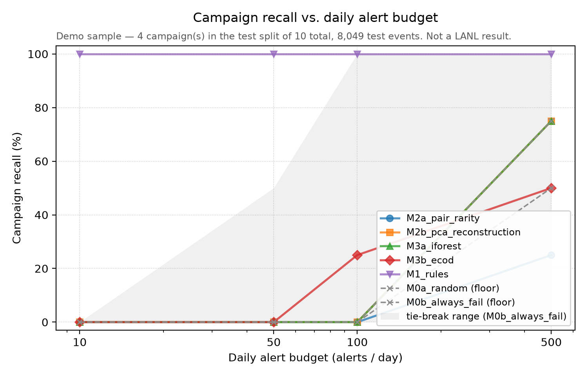

# AuthBench

**What does published anomaly-detection performance become under a realistic
alert budget?** A leak-free, budget-constrained benchmark on the LANL
Comprehensive Multi-Source Cyber-Security Events dataset.

[](https://github.com/SaniAdamou14/AuthBench/actions/workflows/ci.yml)
[](https://doi.org/10.5281/zenodo.23159767)
[](https://doi.org/10.5281/zenodo.23183808)

**Report:** [`reports/paper/main.tex`](reports/paper/main.tex) (version 2, in
preparation; version 1 is archived at
[doi.org/10.5281/zenodo.23159768](https://doi.org/10.5281/zenodo.23159768)).
**Code of version 1.0.0:** [doi.org/10.5281/zenodo.23183808](https://doi.org/10.5281/zenodo.23183808).

> A SOC cannot triage more than a few dozen alerts per day per analyst. Most
> published anomaly-detection results are reported at operating points no
> analyst could ever use. AuthBench does not propose a new model: it
> measures, under a strictly temporal, leak-free protocol and a realistic
> daily alert budget, what survives.
>
> **The question it was built to ask (how much of the published deep-learning
> advantage over well-built heuristics survives that constraint) is not
> answered yet.** The LANL runs evaluate seven heuristic, statistical and
> classical outlier detectors; the deep models are implemented and tested but
> have not run on real data (see [State of the project](#state-of-the-project)).

> **Correction notice (21 October 2026).** Version 1 of the report contains two
> errors. It attributes "87.0 average precision" to Tuor et al. (2018), whose
> "AP" is the *average percentile* of malicious events in a daily ranking; and
> it states that no published work on LANL reports a budget-constrained metric
> next to the aggregate one on the same models, which is false (Larroche 2025,
> UltraLMD++; see also DECADES and ADSAGE). Version 2 corrects both and is
> built on the wider-window run below.

## The result

Measured on **real LANL data**: train days 0–7, validation 8–10, test 11–13,
with two days of history before validation and test (training starts cold at
day 0). The test partition holds
54,690,768 authentication events and 282 red-team events in **52 campaigns**.
Provenance and caveats:
[`reports/lanl/wider_window_results/RUN.md`](reports/lanl/wider_window_results/RUN.md).

| Model | AUC-PR [95% CI] | ROC-AUC | Recall @ FPR 1e-4 | Camp. recall @10–500 | Budget for 1st detection | P(random ≤ it) |
|---|---|---:|---:|---:|---:|---:|
| M0a random *(floor)* | 5.05e-6 [2.37e-6, 9.54e-6] | 0.488 | 0.0% | 0% | 85,070 | 69.7% |
| M0b always-fail *(floor)* | 5.16e-6 [2.52e-6, 8.98e-6] | 0.496 | 0.0% | 0% | 5,505,419 | 100% |
| M1 rules | 4.69e-4 [1.88e-4, 9.37e-4] | 0.563 | **3.9%** | 0% | **999** | **1.4%** |
| M2a pair rarity | **7.75e-4** [2.57e-4, 1.66e-3] | **0.941** | 2.1% | 0% | 2,852 | 3.9% |
| M2b PCA reconstruction | 3.50e-5 [2.01e-5, 5.78e-5] | 0.930 | 0.4% | 0% | 1,569 | 2.2% |
| M3a Isolation Forest | 1.92e-5 [7.91e-6, 3.86e-5] | 0.876 | 0.0% | 0% | 141,522 | 86.3% |
| M3b HBOS | 3.32e-5 [1.26e-5, 6.91e-5] | 0.884 | 0.0% | 0% | 104,963 | 77.1% |

**Not one of the seven detects a single campaign at 10, 50, 100 or 500 alerts
per day, whatever the order of tied scores**: every tie bracket is `[0, 0]`.

**The budget for first detection is what the zeros hide**, and it has to be
read against chance. Under a uniformly random ranking of these test days it has
an exact distribution (`evaluate.budget.random_first_detection_survival`):
median 49,373, central 95% range [1,806, 261,368]; a random ranking detects a
campaign within 500 alerts with probability 0.7%. Only the rule engine (999:
1.4% of random rankings do as well) and PCA (1,569: 2.2%) fall below that range.
Pair rarity (3.9%) is inside it, and Isolation Forest (86.3%) and HBOS (77.1%)
are indistinguishable from a random ranking, although their ROC-AUC is 0.876 and
0.884. (M0a's 85,070 is one draw
of that distribution, not a threshold.)

**Orderings.** Over the five non-trivial models, Spearman's correlation with
the budget for first detection is −0.10 for ROC-AUC, 0.70 for AUC-PR and 0.87
for recall at FPR 1e-4. Exact permutation p-values: 0.95, 0.23, 0.10; none is
significant with five models. Without M1, ROC-AUC and AUC-PR order the other
four identically (both 0.80): the contrast rests on the one label-calibrated
detector.

Pairwise AUC-PR: 18 of 21 differences reach a Holm-adjusted value at the
bootstrap's floor (0.0210); pair rarity versus rules does not (0.333). With
R = 2000 the floor is a Monte Carlo estimate whose 95% bound (0.063) exceeds
0.05, and every resample contains the same intrusion, so these describe the
stability of the ordering under resampling of the compromised accounts, not
significance across intrusions. M3b ECOD was excluded before fitting (memory).

> **Three facts bound every number above.**
> 1. **One intrusion, not 52.** 275 of the 282 test red-team events, and 50 of
>    the 52 campaigns, start from one source host, C17693; the labelled LANL
>    activity is a single simulated intrusion (Larroche, 2026). Campaigns are
>    the bootstrap's resampling unit, so the intervals describe the accounts
>    and phases of one operation, not a population of attacks.
> 2. **Unequal access to labels.** M1's rule weights are calibrated on
>    validation labels; every other model is unsupervised with default
>    hyperparameters.
> 3. **Two transductive models.** M1 rank-normalises its rules within the
>    scored partition and ECOD recomputes its distributions from the scored
>    matrix: no label crosses the boundary, but scores depend on the test
>    distribution.
>
> Full list: [`docs/limitations.md`](docs/limitations.md).

### The earlier single-day run

The first LANL run (23 August 2026), on an 8 GB machine, used one day per
partition (train day 5, validation day 8, test day 12, 39 campaigns) and no
warm-up: [`reports/lanl/RUN.md`](reports/lanl/RUN.md). Its ROC-AUC values are
close to the run above (pair rarity 0.942 against 0.941); its one non-zero
operational result, M1 catching 2 of 39 campaigns at 500 alerts/day, does not
survive the wider window and warm-up. Both factors changed together, so the
change is reported, not attributed.

## The same protocol on the synthetic sample



Committed output of `make demo`, regenerated byte for byte by CI on every push;
full provenance in [`reports/demo/RUN.md`](reports/demo/RUN.md). 37,844
synthetic events, 10 red-team campaigns, 4 of them in the test split. Kept
because it is the **control** that makes the LANL result readable, not because
it is a finding.

| Model | AUC-PR [95% CI] | ROC-AUC | Camp. @10 | @50 | @100 | @500 | Budget→1st |
|---|---|---:|---:|---:|---:|---:|---:|
| M0a random *(floor)* | 0.0016 [0.0005, 0.0039] | 0.497 | 0% | 0% | 0% | 50% | 162 |
| M0b always-fail *(floor)* | 0.0014 [0.0002, 0.0030] | 0.491 | 0% | 0% *[0–50]* | 0% *[0–100]* | 75% *[0–100]* | 165 |
| M2a pair rarity | 0.0025 [0.0003, 0.0107] | 0.477 | 0% | 0% | 0% | 25% | 294 |
| M2b PCA reconstruction | 0.0040 [0.0007, 0.0135] | 0.783 | 0% | 0% | 0% | 75% | 114 |
| M3a Isolation Forest | 0.0042 [0.0007, 0.0105] | 0.798 | 0% | 0% | 0% | 75% | 282 |
| M3b ECOD | 0.0046 [0.0005, 0.0187] | 0.690 | 0% | 0% | 25% | 50% | 83 |
| **M1 rules** | **0.3305 [0.0840, 0.6423]** | 0.911 | **100%** | **100%** | **100%** | **100%** | **1** |

*Italic brackets are the tie-break range: M0b scores every event 0 or 1, so at
budget 500 some 7,899 equally-scored events compete for 1,350 places and the
recall printed is whichever of them the ordering happened to reach. Every other
model's score is continuous enough that the bracket collapses onto the point
estimate, which is why only one row carries one.*

**Read the Isolation Forest row twice.** ROC-AUC 0.798, a number that would
pass without comment in a paper, and it catches **nothing** at 10, 50 or 100
alerts a day. The two registers do not merely differ in scale; they rank
differently and they disagree about whether the model works at all. That gap is
what the benchmark exists to measure, and it does not depend on the sample being
realistic: it is a property of the operating point.

**Then read the last column, which is the one that does not saturate.** Four
models print `0% 0% 0%` and the recall row ranks them as equally far from
working. They are not: M3b ECOD needs a budget of 83 to catch its first
campaign, M2b PCA 114; M3a Isolation Forest needs **282**, M2a pair rarity
**294**, both above the random floor's single draw of 162 (one realisation
of a random ranking, not a threshold). A column of zeros hid a
factor of three between models it presented as identical, and hid two ML models
losing to a random scorer.

8 of the 21 pairwise comparisons are significant after Holm-Bonferroni; the
other 13 are not, and are reported as not. All eight sit on the resolution
floor and print as `Holm-adjusted p ≤ 0.0420` against a threshold of 0.05;
see [below](#the-significant-results-are-bounds-not-measurements). Four
campaigns in a test split is a small sample and the intervals say so.

### M1's 100% is partly circular, and here is the measurement

The rules do not win this sample on merit alone. `scripts/generate_demo_data.py`
emits each campaign as a chain: the user authenticates A→B, then B→C, and M1's
rule R7 tests for exactly that: *previous destination equals current source,
within 30 minutes*. The generator and the rule implement **the same predicate**,
so R7 was handed the answer:

| Rule | mean score, benign | mean score, malicious | ratio |
|---|---:|---:|---:|
| **R7 lateral chain** | 0.0056 | 0.6364 | **113×** |
| R6 new auth type | 0.1539 | 0.5455 | 3.5× |
| R1 new pair | 0.3950 | 1.0000 | 2.5× |
| R4 off-hours | 0.7237 | 0.6406 | 0.9× *(no discrimination)* |
| R2 / R3 / R5 | 0.0127 / 0.0326 / 2.5547 | 0.0000 | never fire on a malicious event |

That table is generated output, not prose: `reports/demo/tables/rule_discrimination.csv`,
rewritten by every `make demo` and covered by the reproducibility check, so
the caveat cannot quietly stop matching the run it describes.

M1's validation-fitted weights then put **0.521 on R7**: more than half its
score. So "well-built heuristics beat every ML model at every budget" is, on
this sample, largely one tautological rule doing the work. R1 contributes
genuinely (real lateral movement does create new user→host pairs); R4 turns out
not to discriminate at all once the night window is calibrated from data rather
than assumed.

This is a property of a **synthetic sample written by the same author as the
rules**, not a finding about heuristics, and no amount of statistical care fixes
it: the campaign-stratified bootstrap will faithfully report a circular result
with correct confidence intervals.

**The LANL runs are the control, and they confirm the diagnosis.** Against a
red team that never heard of R7, the same M1 detects no campaign within 500
alerts a day on the wider-window run (its first detection needs 999), and 2 of
39 at 500 on the single-day run. A synthetic benchmark cannot tell you whether
your heuristic is good or merely well-informed; only an adversary who did not
read your rules can.

## Try it in under a minute

No 6 GB download and no 161 GB of disk required. `data/demo/` ships a small
synthetic sample
(versioned in git) shaped like LANL: same 9-column schema, same `?` null
sentinel, machine accounts, per-user home machines, and carrying ten complete
red-team lateral-movement campaigns.

```bash
make install     # uv sync --extra classical --extra dev --locked
make demo        # ~40 s
```

Or without `make`:

```bash
uv sync --extra classical --extra dev --locked --python 3.11
.venv/bin/authbench demo          # .venv\Scripts\authbench demo on Windows
```

This runs ingest → clean → label → temporal split → features F1–F4 →
M0/M1/M2/M3 → evaluation, and writes to `reports/demo/`:

| Artifact | What it is |
|---|---|
| `reports/demo/tables/demo_results.json` | every metric, per model |
| `reports/demo/tables/pairwise_comparisons.json` | pairwise AUC-PR tests, Holm-Bonferroni corrected |
| `reports/demo/tables/campaign_summary.csv` | one row per red-team campaign |
| `reports/demo/tables/rule_discrimination.csv` | per-rule separation and calibrated weight, before aggregation (US-118) |
| `reports/demo/figures/campaign_recall_vs_budget.png` | the headline figure |
| `reports/demo/data_quality.json` | null rates, cardinalities, counted drops |

`reports/demo/` and `reports/lanl/` are the two directories of pipeline output
that *are* committed,
so the results can be read without running anything, and CI asserts the demo
regenerates byte for byte. `reports/tables/` and `reports/figures/` stay
gitignored: they are the working directory a run writes into, and
`reports/lanl/` is the snapshot of the one that was published.

### What the demo sample is

| | |
|---|---|
| Auth events | 37,844 |
| Period | 14 days |
| Red-team events | 27, in 10 campaigns |
| Campaigns per partition | train 3 · val 3 · **test 4** |
| Positive rate | 7.1 × 10⁻⁴ (≈1,000× LANL's, a smoke test, not a scale model) |
| Split | train days 0–7, val 8–10, test 11–13 |

Every partition carries campaigns, and the counts are load-bearing rather than
decorative. A validation window with no positives silently reduces M1's weight
calibration to a single arbitrary random draw. A *test* window with only one
campaign is worse: campaigns are the independent unit of the bootstrap, so one
campaign is a sample size of one, and the comparison table comes back 21 pairs
out of 21 "significant" off a single attack, which is what this sample used to
do. `tests/unit/test_demo_sample_integrity.py` guards both, and
`authbench data generate-demo` regenerates the sample.

## The real dataset

```bash
make install-lanl                             # adds dvc + mlflow; `make install` has neither
source .venv/bin/activate                     # .venv\Scripts\Activate.ps1 on Windows
authbench preflight                           # disk + RAM budget, before downloading anything
export AUTHBENCH_LANL_EMAIL=you@example.org   # required, see below
authbench data download --dataset lanl
authbench data to-parquet data/raw/auth.txt.gz --out-dir data/interim/auth
dvc repro
```

**Activate the environment first.** `dvc repro` runs each stage's command in a
subshell with the ambient `PATH`, so calling `.venv/bin/dvc` directly is not
enough: the stage then fails with `'authbench' is not recognized`. Activating
puts `authbench` and `python` where every stage can find them.

**Run `authbench preflight` first, and read what it says.** The download is
about 6 GB; converting all 58 days and building features is about **81 GB of
disk and 49 GB of RAM**, down from 161 GB and 439 GB, see
[`docs/scaling.md`](docs/scaling.md) for what changed and what it cost (nothing:
`reports/demo/` regenerates byte for byte after every one of those changes).

On a laptop, run a **day window** instead. Days 0–13 is about 254 million real
LANL events in 24 GB of disk and 12 GB of RAM:

```bash
authbench preflight --events 253800000
authbench data to-parquet data/raw/auth.txt.gz --out-dir data/interim/auth --days 0:13
```

`preflight` exits non-zero when a run does not fit, and names the event count
that would. Label every number a partial run produces with the window it came
from: `to-parquet` refuses to reconcile a day window against the published
full-dataset row count rather than failing a check nobody could pass.

The expected row count comes from `conf/dataset/lanl.yaml`, not from the
command line: it is a published figure (1,051,430,459) and repeating it in
`dvc.yaml`, in this README and in a shell history is how it eventually
disagrees with itself.

LANL serves `cyber1` from behind a click-through data-use form rather than a
static URL, so `authbench data download` submits an email plus a usage
statement to obtain a token (`ingest.download.fetch_lanl_fence_token`) and
builds the file URLs from it. The address is read from `--email` or
`AUTHBENCH_LANL_EMAIL` and is never written into `conf/`.

LANL publishes no per-file checksums. The first successful download prints
the SHA-256 it computed; record it under `sha256:` in
`conf/dataset/lanl.yaml` and every later run verifies against it and aborts
on mismatch.

| | |
|---|---|
| Source | LANL Comprehensive, Multi-Source Cyber-Security Events (Kent, 2015) |
| Period | 58 consecutive days |
| Auth events | 1,051,430,459 |
| Red-team events | 749 raw, 715 unique (34 exact duplicates, counted by `clean_redteam`) |
| Positive rate | ≈ 7.1 × 10⁻⁷ |

## Architecture

```
LANL auth.txt.gz + redteam.txt.gz
  -> ingest   (token + resumable download + SHA-256 verify)
  -> parse    (typed schema, machine accounts, explicit nulls, counted drops)
  -> Parquet, partitioned by day, ZSTD
  -> label    (exact quadruplet join, campaign grouping)
  -> split    (temporal train/val/test, leak-free by construction)
  -> features (F1 event, F2 history, F3 novelty, F4 temporal, F5 graph, F6 sequence)
  -> feature store (Parquet, versioned by config hash)
  -> models   (M0 floors, M1 rules, M2 stats, M3 classical, M4 deep, M5 graph)
  -> evaluate (AUC-PR, recall@budget, campaign recall, TTD, bootstrap CIs)
```

Two things are *fitted*, and both are fitted on the training split alone: the
night window (`features.temporal.calibrate_night_window`) and the F1 category
frequency tables (`features.event.fit_frequency_encoding`). Refitting either
per split is a leak that no downstream check catches: it just makes the
numbers better. `tests/unit/test_frequency_encoding.py` holds that line.

Full design rationale: [`AuthBench_Specification.md`](AuthBench_Specification.md).
Implemented protocol: [`docs/methodology.md`](docs/methodology.md).

## Saying "outperforms" only when it is earned

Confidence intervals and pairwise tests come from **one** campaign-stratified
resampling pass shared by every model, so the intervals and the comparisons
sit on the same sampling distribution and each difference is paired.

Three floors sit under this. Two of them produce results that look exactly
like a genuine "no difference" finding, and one produces the opposite (a
clean sweep of "outperforms") while having nothing to do with the models:

- **Degenerate resamples.** A ranking metric over zero positives is
  undefined, but scikit-learn returns 0.0, so on such a resample every model
  ties, and those ties land in both tails of a two-sided test. With one
  campaign in the test split, ~37% of resamples are degenerate and every
  p-value is floored near 0.74. They are discarded and redrawn;
  `n_degenerate_discarded` is reported, because a high count is itself a
  finding about the split.
- **Bootstrap resolution vs. Holm.** A percentile bootstrap cannot report a
  p-value below `2/(R+1)`, and Holm's strictest threshold is `alpha/n_pairs`.
  For the 8-model catalog that needs `R ≥ 1119`; the config's original 1000
  could never have produced a single significant result.
  `stats_tests.minimum_resamples_for_family` computes the bound and warns
  when it is not met.
- **One campaign is not a sample.** The sample size of a campaign-stratified
  bootstrap is the number of *campaigns*, not the number of events. With a
  single campaign in the test split, every resample is a re-weighting of the
  same attack: no pairwise difference can change sign, the tail count is zero,
  and every p-value lands on the resolution floor `2/(R+1)`, which is *below*
  Holm's threshold, so all 21 demo comparisons came back "outperforms" off one
  campaign. That is the bootstrap's resolution being reported as evidence
  about the models. `stats_tests.MIN_CAMPAIGNS_FOR_SIGNIFICANCE` withholds the
  verdict below two campaigns; the point estimates and intervals still stand,
  and `authbench demo` now prints 0/21 with the reason.

### The significant results are bounds, not measurements

The third floor above is not only a hazard for a one-campaign split. It applies,
in a weaker form, to **almost every significant result this project has
published**, so it is stated here rather than left for a reader to derive:

| run | significant | of those, on the resolution floor |
|---|---:|---:|
| demo (R = 1000, 21 pairs) | 8 | **8** |
| LANL single day (R = 2000, 21 pairs) | 13 | **12** |
| LANL wider window (R = 2000, 21 pairs) | 18 | **18** |

A pair lands on the floor when not one resample out of R put the difference on
the other side of zero. The two-sided p-value is then `2/(R+1)` because that is
the smallest number the bootstrap can express, not because anything was
measured there. Reported honestly, those comparisons say `Holm-adjusted
p ≤ 0.0420` (demo) and `≤ 0.0210` (LANL) against a threshold of 0.05: true, and
a factor of 1.2 and 2.4 of margin respectively. That is a real result and a thin
one, and the two facts belong in the same sentence.

Three things follow, all of them now mechanical rather than editorial:

- `at_resolution_floor` is recorded per comparison in
  `pairwise_comparisons.json`, and `render_p_value` prints `≤` instead of `=`
  whenever it is set.
- `p_value_raw` and `p_value_holm_adjusted` are separate fields. The JSON key
  used to be a single `p_value_corrected` that carried the **uncorrected**
  number; Holm was only ever applied as a decision rule, never folded into the
  value printed next to the word "corrected".
- Raising `R` is what buys resolution. Nothing else does, and no amount of
  care with the wording substitutes for it.

The one comparison of the single-day run that is *not* on the floor (M0b
always-fail versus M1 rules) lands at Holm-adjusted `p = 0.0450`. On the wider
window, every significant verdict is on the floor.

### And the alert budget had a floor of its own: the tie-break

"Top 10 events of the day" is not a question a model answers on its own. A model
whose score takes few distinct values leaves the ordering to whatever sorts the
frame, and for most of this project's history that was **the row order**,
which after `features.temporal.compute_f4` is `(src_user, time)`. The published
M0b always-fail row was therefore, literally, *the failures of the
alphabetically earliest users*.

Measured on the demo test split, M0b puts 2,619 equally-scored events in
competition for 8 of day 11's places. Under the old ordering it caught nothing
at any budget; under arrival order it catches 3 of 4 campaigns at budget 500.
Neither number is wrong: the metric simply did not have enough information to
produce one, and said nothing about it.

Three changes, in `evaluate/budget.py`:

- ties break on `(time, event_id)`: arrival order, which is what a queue does
  and what an analyst working a shift does. Label-free, total, and stated:
  `ALERT_ORDER_TIE_BREAK`.
- `campaign_recall_bracket` reports what the tie could have cost or bought. The
  low end is exact; the high end is achievable. A zero-width bracket certifies
  that the tie-break decided nothing, which is the case for every model here
  except M0b.
- `tie_exposure` publishes the slots and the contenders per budget, so the
  bracket's width has a stated cause.

The headline figure shades the bracket and names it in the legend. Every model
with a continuous score draws no band at all, and that absence is the point:
the shading marks exactly the numbers that are soft.

### `budget_for_first_detection`: the column that does not saturate

A recall table of `0% 0% 0% 0%` ranks every model that failed as equally far
from succeeding. A model whose best campaign sits at rank 600 and one whose best
sits at rank 9,000,000 print identically, and the benchmark's central claim,
*nothing works at an operational budget*, is exactly the regime where that
table stops discriminating.

A campaign is detected at budget `k` precisely when one of its events reaches
rank `k` or better in its own day, so the smallest budget that detects anything
is the minimum rank over all campaign events: one pass, exact, no sweep. On the
demo sample it separates four models the recall row called identical (83 / 114 /
282 / 294). On the LANL wider window it spans 999 to 141,522 alerts a day,
and `random_first_detection_survival` places each value against its exact
distribution under a random ranking. `authbench demo`
prints it as `Budget→1st`; `metrics_summary.json` carries it under
`operational.budget_for_first_detection`.

## State of the project

Being explicit about this is part of the point of the benchmark.

**Done**

- **The wider-window LANL run** (primary): train 0–7, validation 8–10, test
  11–13, two warm-up days, 52 test campaigns, on rented hardware.
  [`reports/lanl/wider_window_results/`](reports/lanl/wider_window_results/RUN.md).
- **The single-day LANL run** (superseded, kept): one day per partition, no
  warm-up, 39 test campaigns. [`reports/lanl/RUN.md`](reports/lanl/RUN.md).

**Runs end to end today**

- Ingest, parse, label, temporal split with a mechanical leakage guard.
- Features F1 (event), F2 (history), F3 (novelty), F4 (temporal).
- Models M0a random, M0b always-fail, M1 rules (7 rules, weights calibrated
  on validation), M2a pair-rarity, M2b PCA reconstruction, M3a Isolation
  Forest, M3b ECOD/HBOS.
- Evaluation, in two registers the report keeps separate:
  - *operational*: event and campaign recall at daily alert budgets,
    time-to-detection per campaign, AUC-PR with campaign-stratified CIs;
  - *literature-comparable*: ROC-AUC, global precision@k, recall at a fixed
    FPR, each reported for placement against published numbers, not ranking.
- Pairwise AUC-PR comparisons across the whole model family, Holm-Bonferroni
  corrected. The report generator can only emit the word "outperforms" on the
  significant branch (`render_comparison_sentence`).

**Implemented and unit-tested, not yet run on LANL**

- M4a autoencoder and M4b VAE: in the `train_eval` catalog when
  `runtime.deep_models: true` (needs the `deep` extra). Bounded, seeded,
  early-stopped fitting; deterministic, row-local scoring.
- F6 sequences on a train-fitted vocabulary, and M4c next-destination LSTM;
  F5 graph features (bipartite clustering, PageRank, Louvain, node2vec) and
  M5a. Neither family is in the feature store yet: F6 needs a streaming
  design to fit LANL's partitions in memory.
- SHAP alert cards (`explain/`): needs the `explain` extra.

Until 21 October 2026 this section described M4, M5 and F5 as unit-tested
when no test covered them. Writing the tests found sixteen defects, all fixed
in commit `c0099e9`.

**Not implemented**

- The R1 (unsupervised) / R2 (semi-supervised) training regimes. The key
  exists in `conf/split/*.yaml`; nothing reads it yet.
- M5b GNN link prediction: raises `NotImplementedError` on purpose rather
  than shipping a decorative implementation.

**The technical report** lives at
[`reports/paper/main.tex`](reports/paper/main.tex) (build instructions in
[`reports/paper/README.md`](reports/paper/README.md), including arXiv
packaging). Version 1 is published as a preprint on Zenodo, DOI
[10.5281/zenodo.23159768](https://doi.org/10.5281/zenodo.23159768); version 2
is in preparation, and arXiv submission in `cs.CR` awaits an endorsement. There is still deliberately no
`report` stage in `dvc.yaml`: LaTeX compilation is not part of the
reproducible pipeline `dvc repro` runs, only of the write-up built on top of
its output.

**This exact code version is archived on Zenodo too**, separately from the
paper: the `v1.0.0` release, DOI
[10.5281/zenodo.23183808](https://doi.org/10.5281/zenodo.23183808), via the
GitHub-Zenodo integration. `CITATION.cff` carries both identifiers, and
GitHub's "Cite this repository" button reads from it directly.

## Development

```bash
make lint        # ruff check + ruff format --check, on src tests scripts
make typecheck   # mypy --strict on src
make test        # pytest with coverage
make demo        # the full pipeline on the demo sample
make preflight   # disk/RAM budget for a full LANL run on this machine
```

CI runs all four on every push and PR, with the `deep` and `graph` extras
installed (CPU-only torch), a coverage gate of 85% on `evaluate/`,
`features/`, `ingest/` and `models/`, a byte-for-byte check of the demo
results, and uploads `reports/` as an artifact.

Requires Python ≥3.11, <3.13. Optional extras: `classical` (PyOD), `deep`
(torch), `graph` (networkx/node2vec), `explain` (shap), `dashboard`
(streamlit), `tracking` (mlflow/dvc), `dev`, `all`.

## Limits

- A single real dataset (LANL, 2015, one enterprise network): transferability
  to modern cloud/MFA environments is not established.
- Red-team labels are a partial ground truth: an unflagged event may still be
  a true compromise never caught at the time.
- One intrusion: 97.5% of the test red-team events start from one host, so
  campaigns are not independent attacks.
- Campaign grouping has no canonical definition; the gap threshold is a
  published parameter, and its sensitivity analysis has not been run yet.
- No adaptive adversary: LANL's red team was not evading these specific models.

Full discussion: [`docs/limitations.md`](docs/limitations.md).
Scope of use: [`docs/ethics.md`](docs/ethics.md).

## Citing the dataset

> Kent, A. D. (2015). *Comprehensive, Multi-Source Cyber-Security Events*.
> Los Alamos National Laboratory. https://doi.org/10.17021/1179829

## License

Code: Apache 2.0 (see `LICENSE`). LANL and CERT data are not redistributed:
only the download scripts are, under the terms of each dataset's own license
(see [`docs/ethics.md`](docs/ethics.md)).
