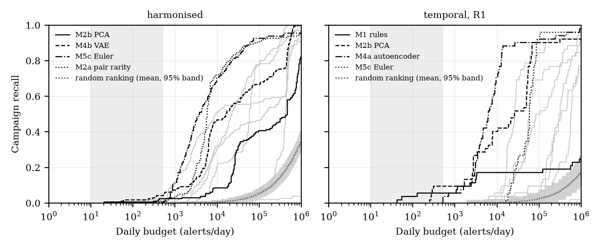

# AuthBench

**At what daily alert budget does an authentication anomaly detector find an
intrusion, and how much of that is the detector?** A temporally leak-free,
budget-constrained evaluation harness, with a case study on the LANL
Comprehensive Multi-Source Cyber-Security Events dataset.

[](https://github.com/SaniAdamou14/AuthBench/actions/workflows/ci.yml)
[](https://doi.org/10.5281/zenodo.23687498)
[](https://doi.org/10.5281/zenodo.23183807)

**Report, version 2:** [doi.org/10.5281/zenodo.23687498](https://doi.org/10.5281/zenodo.23687498)
(a separate record, because a Zenodo issue,
[zenodo/zenodo-rdm#1501](https://github.com/zenodo/zenodo-rdm/issues/1501), blocks new versions of version 1's record),
source [`reports/paper/main.tex`](reports/paper/main.tex), built on the full LANL run of
22 October 2026; version 1 is archived at
[doi.org/10.5281/zenodo.23159768](https://doi.org/10.5281/zenodo.23159768).
**Code, all versions:** [doi.org/10.5281/zenodo.23183807](https://doi.org/10.5281/zenodo.23183807)
(release v2.2.0, [10.5281/zenodo.23843172](https://doi.org/10.5281/zenodo.23843172), corrects one bound of report version 2;
v2.1.0, [10.5281/zenodo.23623196](https://doi.org/10.5281/zenodo.23623196), is the code of report version 2; v2.0.0 is
[10.5281/zenodo.23588281](https://doi.org/10.5281/zenodo.23588281) and v1.0.0
[10.5281/zenodo.23183808](https://doi.org/10.5281/zenodo.23183808)).

> A SOC cannot triage more than a few dozen alerts per day per analyst, yet
> anomaly detectors for authentication logs are mostly compared by
> threshold-free metrics, which average over operating points no analyst could
> staff. AuthBench does not propose a new model: it measures, under a
> temporally leak-free protocol and a daily alert budget, what a detector finds
> and how much of it is due to the detector.

> **Correction notice (21 October 2026).** Version 1 of the report contains two
> errors. It attributes "87.0 average precision" to Tuor et al. (2018), whose
> "AP" is the *average percentile* of malicious events in a daily ranking; and
> it states that no published work on LANL reports a budget-constrained metric
> next to the aggregate one on the same models, which is false (Larroche 2025,
> UltraLMD++; see also DECADES and ADSAGE). Version 2 corrects both.

## The result

The full LANL run of 22 October 2026 evaluates eleven detectors and two floors
(rules with and without labels, rarity scores, PCA, three outlier detectors, two
autoencoders and Euler) on all 58 days, under two protocols; ten of the detectors
are distinct in the harmonised protocol below, where M1 reduces to M1u. Provenance, every
number and every caveat:
[`reports/runs/20261022T102638Z/RUN.md`](reports/runs/20261022T102638Z/RUN.md).



*Campaign recall as a function of the daily budget in events, from each campaign's detection budget (arrival tie order); shaded: 10 to 500 alerts a day. Generated by `scripts/paper_assets.py`, figure 2 of the report.*

**Harmonised protocol** (Larroche, 2026): train on hours 0-41, test on hours
41-1392 (57 days, 702 red-team events in 162 campaigns over 98 accounts), no
label read anywhere. Its 369,569,626 events and 702 positives are exactly the
LANL event set of Larroche (2026, Table 4).

| Model | AUC-PR [95% BCa] | ROC-AUC | Camp. @500 events | Camp. @500 user-days | Budget for 1st detection | P(random ≤ it) |
|---|---|---:|---:|---:|---:|---:|
| M0a random *(floor)* | 1.96e-6 [1.36e-6, 3.18e-6] | 0.504 | 0.0% | 4.3% | 16,718 | 0.816 |
| M0b always-fail *(floor)* | 1.95e-6 [1.38e-6, 3.20e-6] | 0.498 | 0.0% | 7.4% | 20,636 | 0.876 |
| M1u rules, uniform (= M1 here) | 1.16e-6 [8.35e-7, 1.78e-6] | 0.244 | 0.0% | 0.0% | 41,065 | 0.984 |
| M2a pair rarity | 4.21e-4 [2.59e-4, 8.78e-4] | 0.949 | 1.2% | 21.6% | 405 | 0.040 |
| M2c source rarity | 1.58e-5 [1.08e-5, 2.83e-5] | 0.926 | 0.0% | 50.6% | 3,737 | 0.314 |
| M2b PCA | 1.23e-5 [7.83e-6, 1.78e-5] | 0.888 | 2.5% | 41.4% | **20** | **0.002** |
| M3a Isolation Forest | 7.37e-5 [4.43e-5, 1.31e-4] | 0.957 | 0.0% | 16.0% | 718 | 0.070 |
| M3b HBOS | 5.92e-5 [4.20e-5, 9.21e-5] | **0.979** | 0.0% | 13.0% | 1,262 | 0.120 |
| M3c ECOD | 1.71e-4 [1.07e-4, 3.60e-4] | 0.972 | 0.0% | 29.0% | 1,691 | 0.157 |
| M4a autoencoder | 3.94e-5 [2.55e-5, 6.85e-5] | 0.935 | 1.9% | 37.7% | 59 | 0.006 |
| M4b VAE | 5.53e-5 [3.52e-5, 9.50e-5] | 0.959 | **4.3%** | 43.8% | 27 | 0.003 |
| M5c Euler | **7.19e-4** [4.75e-4, 1.24e-3] | 0.961 | 0.6% | 51.2% | 203 | 0.020 |
| *Most distinct destinations that day (no detector, no label)* | | | | **56.8%** | | |

- **No detector catches a campaign at 10 alerts a day**, in either protocol.
  At 500 events a day the best is 4.3% of the campaigns (harmonised, VAE) and
  9.6% (temporal, PCA, tuned on validation labels).
- **Read at the level of the intrusion**, the autoencoder alerts on the attack's
  first test day at 100 alerts a day, and PCA and the VAE a week later at 50,
  but none of these is established beyond one fit: PCA does so in 2 of its 5
  fits, the others were fitted once, and the first day is partial (hours 41 to
  47): without it the autoencoder's first detection moves from 59 to 528.
- **Threshold-free metrics and budgets**: in the harmonised protocol, which reads
  no label, neither ROC-AUC (ρ = 0.55 with the median campaign budget, Holm
  p = 0.734) nor AUC-PR (0.79, p = 0.100) orders the detectors by their
  campaign budgets; a campaign-weighted AP does (0.93, p = 0.005). No metric
  orders them by first detection; with ten detectors, that is absence of
  evidence, not independence.
- **Another seed is another result**: PCA's harmonised first detection ranges
  from 13 to 243 alerts a day over five fitting seeds (median 137); the
  autoencoders and Euler were fitted once.
- **Units measure fan-out**: ranked as user-days, Euler and source rarity reach
  about half of the campaigns at 500 a day, but ranking each day's users by how
  many distinct computers they touched, with no detector and no label, reaches
  56.8% (30.2% at 50 a day, against 13.6% for Euler). No detector beats that
  count. Against random event scores aggregated by their maximum (6.0% at 500)
  most detectors still stand out; against a uniform ranking of user-days (3.0%)
  everything does, which is why that null was the wrong one. Computed after the
  run by `scripts/user_day_activity.py`.
- **A threshold fixed on the 41 training hours does not hold**: calibrated for
  10 alerts a day, PCA raises 149 a day on average on the test, 8,222 on its
  worst day.
- **Euler**: the authors' own code, rerun on the same machine with its released
  preprocessing and the defaults of its run script (hidden sizes 32 and 16,
  learning rate 0.005), stays within 0.003 of its published AUC (0.9879 against
  0.9906) and below half its published average precision in all five runs (at
  most 0.0080 against 0.0155). Its first author answered on 23 October 2026: the
  published row is a mean of five runs and probably used hidden sizes 64 and 32
  with a learning rate of 0.01. That configuration has not been run yet, so the
  AP gap is a result about the released defaults, not about the published run.
  AuthBench's reimplementation reaches 0.9570 and 0.0027 on the same test
  events, and the test sets are reconciled edge by edge with the paper's counts.

**Temporal protocol** (train days 0-7, validation 8-10, test 11-13, all
events, 282 red-team events in 52 campaigns): M1, its weights tuned on
validation labels, first detects at 42 alerts a day and catches 1, 2 and 3
campaigns at 50, 100 and 500; with uniform weights the same rules rank the red
team below benign traffic (ROC-AUC 0.244), because machine-account and
failure rules point the wrong way on LANL. Removing the 50 training red-team
events (regime R2) moves Euler's first detection from 15,945 to 8,481 and the
autoencoder's from 494 to 1,565, changes that cannot be separated from fitting
noise with one fit each.

> **One intrusion, not 162 campaigns.** 683 of the 715 distinct red-team events
> (95.5%) start from one source computer, C17693, and only four source
> computers appear at all; the labelled LANL activity is a single simulated
> intrusion (Larroche, 2026). Every interval and p-value describes the accounts
> and phases of one operation. Full list of limitations:
> [`docs/limitations.md`](docs/limitations.md).

### Earlier runs

The wider-window run of 15 September 2026
([`reports/lanl/wider_window_results/RUN.md`](reports/lanl/wider_window_results/RUN.md))
evaluated seven detectors on the temporal partitions with the earlier code; the
single-day run of 23 August 2026 ([`reports/lanl/RUN.md`](reports/lanl/RUN.md))
used one day per partition on an 8 GB machine. Both are kept unchanged; the
report's appendix compares the September and October numbers on the same
partitions.

## The same protocol on the synthetic sample


Committed output of `make demo`, regenerated byte for byte by CI on every push;
full provenance in [`reports/demo/RUN.md`](reports/demo/RUN.md). 37,844
synthetic events, 10 red-team campaigns, 4 of them in the test split. Kept
because it is the **control** that makes the LANL result readable, not because
it is a finding.

| Model | AUC-PR [95% CI] | ROC-AUC | Camp. @10 | @50 | @100 | @500 | Budget→1st |
|---|---|---:|---:|---:|---:|---:|---:|
| M0a random *(floor)* | 0.0018 [0.0005, 0.0059] | 0.543 | 0% | 0% | 25% | 25% | 79 |
| M0b always-fail *(floor)* | 0.0014 [0.0005, 0.0036] | 0.491 | 0% | 0% *[0–50]* | 0% *[0–100]* | 75% *[0–100]* | 165 |
| M2a pair rarity | 0.0024 [0.0004, 0.0077] | 0.577 | 0% *[0–100]* | 0% *[0–100]* | 0% *[0–100]* | 100% *[0–100]* | 121 |
| M2c source rarity | 0.0031 [0.0009, 0.0085] | 0.751 | 0% *[0–50]* | 0% *[0–50]* | 0% *[0–50]* | 50% *[0–50]* | 121 |
| M2b PCA reconstruction | 0.0294 [0.0016, 0.2032] | 0.889 | 25% | 25% | 50% | 100% | 4 |
| M3a Isolation Forest | 0.0090 [0.0025, 0.0275] | 0.921 | 0% | 25% | 50% | 100% | 49 |
| M3b ECOD | 0.0026 [0.0007, 0.0101] | 0.662 | 0% | 0% | 0% | 50% | 232 |
| **M1 rules** | **0.4395 [0.1006, 0.6757]** | 0.971 | **100%** | **100%** | **100%** | **100%** | **1** |
| M1u rules, uniform weights *(no label)* | 0.0191 [0.0016, 0.1437] | 0.867 | 25% | 25% | 25% | 75% | 4 |

*Italic brackets are the tie-break range: the recall under the least and the
most favourable ordering of equally scored events. M0b scores every event 0 or 1,
so at budget 500 some 7,899 equally scored events compete for 1,350 places.
M2a and M2c are wide too, by design since 22 October 2026: their rarity is
anchored to the start of the day, so two events that are equally new on the same
day tie, and the bracket shows how much the tie order decides. Before, the time
of day broke those ties inside the score, invisibly.*

**Read the Isolation Forest row twice.** ROC-AUC 0.921, a number that would
pass without comment in a paper, and it catches nothing at 10 alerts a day, where
M1u, at ROC-AUC 0.867, already catches a campaign. The two registers do not
merely differ in scale; they rank differently.

**Then read the last column, which is the one that does not saturate**, and
read it against chance: `budget_summary.json` places every budget against random
rankings of the same campaigns, with intervals from a bootstrap over accounts.
M0a's 79 is one draw of that distribution, not a threshold.

**The source side matters even here.** Adding the user-source and
source-destination relations to the design matrix (F3, 22 October 2026) moved
PCA's first detection from 114 alerts a day to 4. This is a synthetic sample;
the LANL run of 22 October 2026 includes these relations.

16 of the 36 pairwise comparisons are significant after Holm-Bonferroni, all 16
on the resolution floor (`Holm-adjusted p ≤ 0.0072` against 0.05); see
[below](#the-significant-results-are-bounds-not-measurements). Four campaigns in
a test split is a small sample and the intervals say so. Since 22 October 2026
M0a hashes `event_id` and ECOD is fitted on training data, every tunable model is
tuned on validation with the same budget of 20 candidates and M1u shows the rules
without labels (those rows changed), and the bootstrap draws from sufficient
statistics (`docs/methodology.md`); on the
same scores both bootstrap schemes give the same verdict on 28 of 28 pairs.
The intervals are BCa over 10,000 resamples of accounts, each endpoint published
with its Monte Carlo range (`auc_pr_ci_monte_carlo`).

### M1's 100% is partly circular, and here is the measurement

The rules do not win this sample on merit alone. `scripts/generate_demo_data.py`
emits each campaign as a chain: the user authenticates A→B, then B→C, and M1's
rule R7 tests for exactly that: *previous destination equals current source,
within 30 minutes*. The generator and the rule implement **the same predicate**,
so R7 was handed the answer:

| Rule | mean score, benign | mean score, malicious | ratio |
|---|---:|---:|---:|
| **R7 lateral chain** | 0.0056 | 0.6364 | **114×** |
| R6 new auth type | 0.1973 | 0.5455 | 2.8× |
| R8 new source | 0.2972 | 1.0000 | 3.4× |
| R1 new pair | 0.3950 | 1.0000 | 2.5× |
| R4 off-hours | 0.7237 | 0.6406 | 0.9× *(no discrimination)* |
| R2 / R3 / R5 | 0.0127 / 0.0326 / 1.7579 | 0.0000 | never fire on a malicious event |

That table is generated output, not prose: `reports/demo/tables/rule_discrimination.csv`,
rewritten by every `make demo` and covered by the reproducibility check, so
the caveat cannot quietly stop matching the run it describes.

M1's weights, chosen on validation from 20 candidates (the budget every tuned
model gets since 22 October 2026), put 0.235 on R7 and 0.303 on R8 (new
source); with the 50 draws of the published configuration they had put 0.579 on R7.
The weight on one rule is not the measurement that matters, though; what choosing
the weights buys is. **M1u**, the same eight rules with uniform weights and no
label, reaches AUC-PR 0.0191 against M1's 0.4395, and
detects 25% of the campaigns at 10 alerts a day against M1's 100%. On this sample,
most of M1's lead comes from weights chosen on validation labels drawn from the same
generator that defines the attacks. R1 contributes genuinely (real lateral movement
does create new user→host pairs); R4 does not discriminate at all once the night
window is calibrated from data rather than assumed.

This is a property of a **synthetic sample written by the same author as the
rules**, not a finding about heuristics, and no amount of statistical care fixes
it: the block bootstrap will faithfully report a circular result
with correct confidence intervals.

**The LANL runs are the control, and they confirm the diagnosis.** Against a
red team that never heard of R7, the same M1 detects no campaign within 500
alerts a day on the wider-window run (its first detection needs 999), and 2 of
39 at 500 on the single-day run. On the full run of 22 October 2026, R7 alone
ranks the red team at a ROC-AUC of 0.32 (temporal) and 0.49 (harmonised). A synthetic benchmark cannot tell you whether
your heuristic is good or merely well-informed; only an adversary who did not
read your rules can.

## Try it in under a minute

No 6 GB download and no 161 GB of disk required. `data/demo/` ships a small
synthetic sample
(versioned in git) shaped like LANL: same 9-column schema, same `?` null
sentinel, machine accounts, per-user home machines, and carrying ten complete
red-team lateral-movement campaigns.

```bash
make install     # uv sync --extra classical --extra dev --locked
make demo        # ~40 s
```

Or without `make`:

```bash
uv sync --extra classical --extra dev --locked --python 3.11
.venv/bin/authbench demo          # .venv\Scripts\authbench demo on Windows
```

This runs ingest → clean → label → temporal split → features F1–F4 →
M0/M1/M2/M3 → evaluation, and writes to `reports/demo/`:

| Artifact | What it is |
|---|---|
| `reports/demo/tables/demo_results.json` | every metric, per model |
| `reports/demo/tables/pairwise_comparisons.json` | pairwise AUC-PR tests, Holm-Bonferroni corrected |
| `reports/demo/tables/campaign_summary.csv` | one row per red-team campaign |
| `reports/demo/tables/rule_discrimination.csv` | per-rule separation and calibrated weight, before aggregation |
| `reports/demo/figures/campaign_recall_vs_budget.png` | the headline figure |
| `reports/demo/data_quality.json` | null rates, cardinalities, counted drops |

`reports/demo/` and `reports/lanl/` are the two directories of pipeline output
that *are* committed,
so the results can be read without running anything, and CI asserts the demo
regenerates byte for byte. `reports/tables/` and `reports/figures/` stay
gitignored: they are the working directory a run writes into, and
`reports/lanl/` is the snapshot of the one that was published.

### What the demo sample is

| | |
|---|---|
| Auth events | 37,844 |
| Period | 14 days |
| Red-team events | 27, in 10 campaigns |
| Campaigns per partition | train 3 · val 3 · **test 4** |
| Positive rate | 7.1 × 10⁻⁴ (≈1,000× LANL's, a smoke test, not a scale model) |
| Split | train days 0–7, val 8–10, test 11–13 |

Every partition carries campaigns, and the counts are load-bearing rather than
decorative. A validation window with no positives silently reduces M1's weight
calibration to a single arbitrary random draw. A *test* window with only one
campaign is worse: campaigns are the independent unit of the bootstrap, so one
campaign is a sample size of one, and the comparison table comes back 21 pairs
out of 21 "significant" off a single attack, which is what this sample used to
do. `tests/unit/test_demo_sample_integrity.py` guards both, and
`authbench data generate-demo` regenerates the sample.

## The real dataset

```bash
make install-lanl                             # adds dvc + mlflow; `make install` has neither
source .venv/bin/activate                     # .venv\Scripts\Activate.ps1 on Windows
authbench preflight                           # disk + RAM budget, before downloading anything
export AUTHBENCH_LANL_EMAIL=you@example.org   # required, see below
authbench data download --dataset lanl
authbench data to-parquet data/raw/auth.txt.gz --out-dir data/interim/auth
dvc repro
```

On a rented machine, `scripts/run_lanl.sh` does all of it in one command: locked install,
preflight, download, conversion of the 58 days, both protocols (`temporal` and `harmonised`)
with the autoencoders and Euler, and Euler's fidelity check, logging the machine, commit,
durations and cost under `reports/runs/<run id>/`:

```bash
AUTHBENCH_LANL_EMAIL=you@example.org HOURLY_EUR=0.4431 bash scripts/run_lanl.sh
```

**Activate the environment first.** `dvc repro` runs each stage's command in a
subshell with the ambient `PATH`, so calling `.venv/bin/dvc` directly is not
enough: the stage then fails with `'authbench' is not recognized`. Activating
puts `authbench` and `python` where every stage can find them.

**Run `authbench preflight` first, and read what it says.** The download is
about 8 GB; converting all 58 days and building features is about **55 GB of
disk and 19 GB of RAM** (22 October 2026: features and evaluation now run one day
at a time, so memory follows the largest day), down from 161 GB and 439 GB, see
[`docs/scaling.md`](docs/scaling.md) for what changed and what it cost (nothing:
`reports/demo/` regenerates byte for byte after every one of those changes).

On a laptop, a **day window** bounds disk (days 0-13: about 254 million real LANL
events, 19 GB) and the **remote LogOn universe** bounds memory (`features.universe`,
largest day about 8 million events, about 7 GB):

```bash
authbench preflight --events 253800000 --days 14
authbench data to-parquet data/raw/auth.txt.gz --out-dir data/interim/auth --days 0:13
```

Features are computed one day at a time, with novelty counts and per-user
profiles carried from day to day (`features/incremental.py`), and written as one
Parquet file per day under `data/processed/features/<version>/<split>/`. Peak
memory is set by a day and its predecessor, not by the length of the run.
Measured on days 0-2 of the real data on the 8 GB reference machine: the remote
LogOn universe (about 6 million events a day) peaks at 4.7 GB and 50 s per day;
all events (about 18 million a day) still exhaust 8 GB on the first day.

Two protocols are configured. `split=temporal` is the published one (train 0-7,
validation 8-10, test 11-13, two warm-up days per partition, all events).
`split=harmonised` follows Larroche (2026): train on the first 41 hours, test on
the rest, remote LogOn events only, every event featurised against all earlier
ones, and no labels used anywhere:

```bash
python -m authbench.pipeline.build_features split=harmonised
python -m authbench.pipeline.train_eval split=harmonised
```

`preflight` exits non-zero when a run does not fit, and names the event count
that would. Label every number a partial run produces with the window it came
from: `to-parquet` refuses to reconcile a day window against the published
full-dataset row count rather than failing a check nobody could pass.

`to-parquet` also refuses an output directory that already holds `day=*`
partitions: parts are named by block, so converting again with another block
size or day window would leave the earlier parts beside the new ones as
duplicated rows. `--overwrite` deletes those partitions first (`dvc repro`
empties the directory itself).

The expected row count comes from `conf/dataset/lanl.yaml`, not from the
command line: it is a published figure (1,051,430,459) and repeating it in
`dvc.yaml`, in this README and in a shell history is how it eventually
disagrees with itself.

LANL serves `cyber1` from behind a click-through data-use form rather than a
static URL, so `authbench data download` submits an email plus a usage
statement to obtain a token (`ingest.download.fetch_lanl_fence_token`) and
builds the file URLs from it. The address is read from `--email` or
`AUTHBENCH_LANL_EMAIL` and is never written into `conf/`.

LANL publishes no per-file checksums. The first successful download prints
the SHA-256 it computed; record it under `sha256:` in
`conf/dataset/lanl.yaml` and every later run verifies against it and aborts
on mismatch.

| | |
|---|---|
| Source | LANL Comprehensive, Multi-Source Cyber-Security Events (Kent, 2015) |
| Period | 58 consecutive days |
| Auth events | 1,051,430,459 |
| Red-team events | 749 raw, 715 unique (34 exact duplicates, counted by `clean_redteam`) |
| Positive rate | ≈ 7.1 × 10⁻⁷ |

## Architecture

```
LANL auth.txt.gz + redteam.txt.gz
  -> ingest   (token + resumable download + SHA-256 verify)
  -> parse    (typed schema, machine accounts, explicit nulls, counted drops)
  -> Parquet, partitioned by day, ZSTD
  -> label    (exact quadruplet join, campaign grouping)
  -> split    (temporal train/val/test, leak-free by construction)
  -> features (F1 event, F2 history, F3 novelty, F4 temporal, F5 graph, F6 sequence)
  -> feature store (Parquet, versioned by config hash)
  -> models   (M0 floors, M1 rules, M2 stats, M3 classical, M4 deep, M5 graph)
  -> evaluate (AUC-PR, recall@budget, campaign recall, TTD, bootstrap CIs)
```

Two things are *fitted*, and both are fitted on the training split alone: the
night window (`features.temporal.calibrate_night_window`) and the F1 category
frequency tables (`features.event.fit_frequency_encoding`). Refitting either
per split is a leak that no downstream check catches: it just makes the
numbers better. `tests/unit/test_frequency_encoding.py` holds that line.

Implemented protocol: [`docs/methodology.md`](docs/methodology.md).

## Reading the code

Where to look to check a claim, in the order the data flows. Paths are under
`src/authbench/` unless they start with `conf/`, `scripts/` or `tests/`. Every
module with code opens with a docstring that says why it exists, and the tests in the
last column hold the property on every push.

| To check | Read | Held by |
|---|---|---|
| A red-team event is matched on its exact time, user, domain, source and destination | `label/redteam_join.py` (`label_auth_events`) | `tests/unit/test_redteam_join.py` |
| Larroche's protocol: train on hours 0-41, test on 41-1392, history from day 0, remote LogOn only | `conf/split/harmonised.yaml`; `pipeline/build_features.py` (`universe_filter`, `split_ranges`, `build_store`) | `tests/integration/test_build_store.py` |
| That event set is exactly Larroche (2026, Table 4): 369,569,626 events, 702 positives | `scripts/paper_assets.py` (`LARROCHE_EVENTS`, `LARROCHE_MALICIOUS`): it refuses to build the report otherwise | the CI step that regenerates the report numbers |
| No partition sees a later one | `split/temporal.py` (`verify_temporal_order`), called by `pipeline/train_eval.py` on the partitions as written | `tests/unit/test_split_temporal.py`; `tests/unit/test_no_test_leakage.py` (no module under `models/` or `features/` may import the test loader) |
| What is fitted is fitted on the training range alone (night window, frequency tables) | `pipeline/build_features.py` (`main`), `features/temporal.py`, `features/event.py` | `tests/unit/test_frequency_encoding.py` |
| Features read only earlier events, day by day with carried state | `features/incremental.py` (`featurize_day`), the families F1 to F4 in `features/` | `tests/unit/test_causality.py`, `tests/unit/test_incremental.py` |
| The contract every detector satisfies, and the catalogue | `models/base.py` (`AnomalyScorer`), `pipeline/train_eval.py` (`build_model_catalog`) | `tests/unit/test_row_locality.py` |
| The daily alert budget, ties and first detection, as readable whole-frame definitions | `evaluate/budget.py` | `tests/unit/test_budget.py`, `tests/unit/test_budget_metrics.py` |
| The same metrics as computed on LANL, one day at a time | `evaluate/statistics.py` (`SplitAccumulator`), fed by `pipeline/train_eval.py` (`score_split`) | `tests/unit/test_statistics.py`, which checks each one against `evaluate/budget.py` and scikit-learn |
| Confidence intervals, and when the report may say "outperforms" | `evaluate/stats_tests.py` | `tests/unit/test_paired_bootstrap.py` |
| Every number, table and figure of the report | `scripts/paper_assets.py`, from `reports/runs/20261022T102638Z/` | CI regenerates `reports/paper/generated/` and fails on any difference |

The report's run was produced by `scripts/run_lanl.sh`, not by `dvc repro`
(see the end of `dvc.yaml`); its commit, machine, data source and logs are in
[`reports/runs/20261022T102638Z/RUN.md`](reports/runs/20261022T102638Z/RUN.md).

## Saying "outperforms" only when it is earned

Confidence intervals and pairwise tests come from **one** block-bootstrap
resampling pass shared by every model, so the intervals and the comparisons
sit on the same sampling distribution and each difference is paired. Since
22 October 2026 the blocks are accounts (every campaign of one account moves
together), R = 10,000, the per-model intervals are BCa, and every p-value and
interval endpoint carries its Monte Carlo error (`docs/methodology.md`).

Three floors sit under this. Two of them produce results that look exactly
like a genuine "no difference" finding, and one produces the opposite (a
clean sweep of "outperforms") while having nothing to do with the models:

- **Degenerate resamples.** A ranking metric over zero positives is
  undefined, but scikit-learn returns 0.0, so on such a resample every model
  ties, and those ties land in both tails of a two-sided test. With one
  campaign in the test split, ~37% of resamples are degenerate and every
  p-value is floored near 0.74. They are discarded and redrawn;
  `n_degenerate_discarded` is reported, because a high count is itself a
  finding about the split.
- **Bootstrap resolution vs. Holm.** A percentile bootstrap cannot report a
  p-value below `2/(R+1)`, and Holm's strictest threshold is `alpha/n_pairs`.
  For the 8-model catalog that needs `R ≥ 1119`; the config's original 1000
  could never have produced a single significant result.
  `stats_tests.minimum_resamples_for_family` computes the bound and warns
  when it is not met.
- **One campaign is not a sample.** The sample size of a block
  bootstrap is the number of *positive blocks*, not the number of events. With a
  single campaign in the test split, every resample is a re-weighting of the
  same attack: no pairwise difference can change sign, the tail count is zero,
  and every p-value lands on the resolution floor `2/(R+1)`, which is *below*
  Holm's threshold, so all 21 demo comparisons came back "outperforms" off one
  campaign. That is the bootstrap's resolution being reported as evidence
  about the models. `stats_tests.MIN_CAMPAIGNS_FOR_SIGNIFICANCE` withholds the
  verdict below two campaigns; the point estimates and intervals still stand,
  and `authbench demo` now prints 0/21 with the reason.

### The significant results are bounds, not measurements

The third floor above is not only a hazard for a one-campaign split. It applies,
in a weaker form, to **almost every significant result this project has
published**, so it is stated here rather than left for a reader to derive:

| run | significant | of those, on the resolution floor |
|---|---:|---:|
| demo (R = 2000, 28 pairs) | 16 | **16** |
| demo since 22 Oct. 2026 (R = 10,000, accounts, 36 pairs) | 16 | **16** |
| LANL single day (R = 2000, 21 pairs) | 13 | **12** |
| LANL wider window (R = 2000, 21 pairs) | 18 | **18** |
| LANL full run, temporal (R = 10,000, accounts, 78 pairs) | 60 | **56** |
| LANL full run, harmonised (R = 10,000, accounts, 78 pairs) | 69 | **68** |

A pair lands on the floor when not one resample out of R put the difference on
the other side of zero. The two-sided p-value is then `2/(R+1)` because that is
the smallest number the bootstrap can express, not because anything was
measured there. Reported honestly, those comparisons say `Holm-adjusted
p ≤ 0.0280` (demo) and `≤ 0.0210` (LANL) against a threshold of 0.05: true, and
a factor of 1.8 and 2.4 of margin respectively. That is a real result and a thin
one, and the two facts belong in the same sentence.

Three things follow, all of them now mechanical rather than editorial:

- `at_resolution_floor` is recorded per comparison in
  `pairwise_comparisons.json`, and `render_p_value` prints `≤` instead of `=`
  whenever it is set.
- `p_value_raw` and `p_value_holm_adjusted` are separate fields. The JSON key
  used to be a single `p_value_corrected` that carried the **uncorrected**
  number; Holm was only ever applied as a decision rule, never folded into the
  value printed next to the word "corrected".
- Raising `R` is what buys resolution. Nothing else does, and no amount of
  care with the wording substitutes for it.

The one comparison of the single-day run that is *not* on the floor (M0b
always-fail versus M1 rules) lands at Holm-adjusted `p = 0.0450`. On the wider
window, every significant verdict is on the floor.

### And the alert budget had a floor of its own: the tie-break

"Top 10 events of the day" is not a question a model answers on its own. A model
whose score takes few distinct values leaves the ordering to whatever sorts the
frame, and for most of this project's history that was **the row order**,
which after `features.temporal.compute_f4` is `(src_user, time)`. The published
M0b always-fail row was therefore, literally, *the failures of the
alphabetically earliest users*.

Measured on the demo test split, M0b puts 2,619 equally-scored events in
competition for 8 of day 11's places. Under the old ordering it caught nothing
at any budget; under arrival order it catches 3 of 4 campaigns at budget 500.
Neither number is wrong: the metric simply did not have enough information to
produce one, and said nothing about it.

Three changes, in `evaluate/budget.py`:

- ties break on `(time, event_id)`: arrival order, which is what a queue does
  and what an analyst working a shift does. Label-free, total, and stated:
  `ALERT_ORDER_TIE_BREAK`.
- `campaign_recall_bracket` reports what the tie could have cost or bought. The
  low end puts benign events first, the minimum when they fill the places left;
  the high end is the exact maximum over tie orders. A continuous score has no
  ties, so its bracket has zero width.
- `tie_exposure` publishes the slots and the contenders per budget, so the
  bracket's width has a stated cause.

The headline figure shades the bracket and names it in the legend. Every model
with a continuous score draws no band at all, and that absence is the point:
the shading marks exactly the numbers that are soft.

### `budget_for_first_detection`: the column that does not saturate

A recall table of `0% 0% 0% 0%` ranks every model that failed as equally far
from succeeding. A model whose best campaign sits at rank 600 and one whose best
sits at rank 9,000,000 print identically, and the benchmark's central claim,
*nothing works at an operational budget*, is exactly the regime where that
table stops discriminating.

A campaign is detected at budget `k` precisely when one of its events reaches
rank `k` or better in its own day, so the smallest budget that detects anything
is the minimum rank over all campaign events: one pass, exact, no sweep. On the
demo sample it spans 1 to 252 alerts a day. On the LANL wider window it spans 999 to 141,522 alerts a day; on the full run's
harmonised protocol, 20 to 41,065,
and `random_first_detection_survival` places each value against its exact
distribution under a random ranking. `authbench demo`
prints it as `Budget→1st`; `metrics_summary.json` carries it under
`operational.budget_for_first_detection`.

## State of the project

Being explicit about this is part of the point of the benchmark.

**Done**

- **The full LANL run of 22 October 2026** (primary, the basis of report
  version 2): all 58 days, the `temporal` split in both regimes and Larroche's
  `harmonised` protocol, with the autoencoders and Euler, Euler's fidelity
  check and the authors' own Euler code on the same machine.
  [`reports/runs/20261022T102638Z/`](reports/runs/20261022T102638Z/RUN.md).
- **The wider-window LANL run** (superseded, kept): train 0–7, validation 8–10,
  test 11–13, two warm-up days, 52 test campaigns, seven detectors, earlier code.
  [`reports/lanl/wider_window_results/`](reports/lanl/wider_window_results/RUN.md).
- **The single-day LANL run** (superseded, kept): one day per partition, no
  warm-up, 39 test campaigns. [`reports/lanl/RUN.md`](reports/lanl/RUN.md).

**Runs end to end today**

- Ingest, parse, label, temporal split with a mechanical leakage guard.
- Features F1 (event), F2 (history), F3 (novelty), F4 (temporal).
- Models M0a random, M0b always-fail, M1 rules (8 rules, weights chosen on
  validation), M1u the same rules with uniform weights and no label, M2a
  pair-rarity, M2c source rarity, M2b PCA reconstruction, M3a Isolation Forest,
  M3b ECOD/HBOS. Every tunable model gets the same budget of 20 candidates on
  validation (`pipeline.tuning`).
- M4a autoencoder and M4b VAE (`runtime.deep_models: true`, the `deep`
  extra) and M5c Euler, reimplemented (`runtime.euler: true`); run on LANL on
  22 October 2026. The autoencoders are not tuned.
- The R1 (unsupervised) and R2 (semi-supervised) training regimes
  (`split.regimes`).
- Evaluation, in two registers the report keeps separate:
  - *operational*: event and campaign recall at daily alert budgets,
    time-to-detection per campaign, AUC-PR with block-bootstrap BCa CIs;
  - *literature-comparable*: ROC-AUC, global precision@k, recall at a fixed
    FPR, each reported for placement against published numbers, not ranking.
- Pairwise AUC-PR comparisons across the whole model family, Holm-Bonferroni
  corrected. The report generator can only emit the word "outperforms" on the
  significant branch (`render_comparison_sentence`).

**Implemented and unit-tested, not yet run on LANL**

- F6 sequences on a train-fitted vocabulary, and M4c next-destination LSTM;
  F5 graph features (bipartite clustering, PageRank, Louvain, node2vec) and
  M5a. Neither family is in the feature store yet: F6 needs a streaming
  design to fit LANL's partitions in memory.
- SHAP alert cards (`explain/`): needs the `explain` extra.

Until 21 October 2026 this section described M4, M5 and F5 as unit-tested
when no test covered them. Writing the tests found sixteen defects, all fixed
in commit `c0099e9`.

**Not implemented**

- M5b GNN link prediction: raises `NotImplementedError` on purpose rather
  than shipping a decorative implementation.

**The technical report** lives at
[`reports/paper/main.tex`](reports/paper/main.tex) (build instructions in
[`reports/paper/README.md`](reports/paper/README.md), including arXiv
packaging). Version 1 is published as a preprint on Zenodo, DOI
[10.5281/zenodo.23159768](https://doi.org/10.5281/zenodo.23159768); version 2,
rewritten on the full run of 22 October 2026 after three rounds of simulated
review (see its AI use disclosure), is
[10.5281/zenodo.23687498](https://doi.org/10.5281/zenodo.23687498), and arXiv submission in `cs.CR` awaits an endorsement. There is still deliberately no
`report` stage in `dvc.yaml`: LaTeX compilation is not part of the
reproducible pipeline `dvc repro` runs, only of the write-up built on top of
its output.

**Every code release is archived on Zenodo too**, separately from the paper, via
the GitHub-Zenodo integration: all versions under
[10.5281/zenodo.23183807](https://doi.org/10.5281/zenodo.23183807), `v1.0.0` as
[10.5281/zenodo.23183808](https://doi.org/10.5281/zenodo.23183808), `v2.0.0` as
[10.5281/zenodo.23588281](https://doi.org/10.5281/zenodo.23588281), `v2.1.0`, the code of report version 2, as
[10.5281/zenodo.23623196](https://doi.org/10.5281/zenodo.23623196), `v2.2.0` as
[10.5281/zenodo.23843172](https://doi.org/10.5281/zenodo.23843172). `.zenodo.json` sets the archive's metadata (author ORCID,
licence, keywords, the link to the report). `CITATION.cff` carries both identifiers, and
GitHub's "Cite this repository" button reads from it directly.

## Development

```bash
make lint        # ruff check + ruff format --check, on src tests scripts
make typecheck   # mypy --strict on src
make test        # pytest with coverage
make demo        # the full pipeline on the demo sample
make preflight   # disk/RAM budget for a full LANL run on this machine
```

CI runs all four on every push and PR, with the `deep` and `graph` extras
installed (CPU-only torch), a coverage gate of 85% on `evaluate/`,
`features/`, `ingest/` and `models/`, a byte-for-byte check of the demo
results, and uploads `reports/` as an artifact.

Requires Python ≥3.11, <3.13. Optional extras: `classical` (PyOD), `deep`
(torch), `graph` (networkx/node2vec), `explain` (shap), `dashboard`
(streamlit), `tracking` (mlflow/dvc), `dev`, `all`.

## Limits

- A single real dataset (LANL, 2015, one enterprise network): transferability
  to modern cloud/MFA environments is not established.
- Red-team labels are a partial ground truth: an unflagged event may still be
  a true compromise never caught at the time.
- One intrusion: 97.5% of the test red-team events start from one host, so
  campaigns are not independent attacks.
- Campaign grouping has no canonical definition; the gap threshold is a
  published parameter, and its sensitivity analysis has not been run yet.
- No adaptive adversary: LANL's red team was not evading these specific models.

Full discussion: [`docs/limitations.md`](docs/limitations.md).
Scope of use: [`docs/ethics.md`](docs/ethics.md).

## Citing the dataset

> Kent, A. D. (2015). *Comprehensive, Multi-Source Cyber-Security Events*.
> Los Alamos National Laboratory. https://doi.org/10.17021/1179829

## License

Code: Apache 2.0 (see `LICENSE`). LANL and CERT data are not redistributed:
only the download scripts are, under the terms of each dataset's own license
(see [`docs/ethics.md`](docs/ethics.md)).
